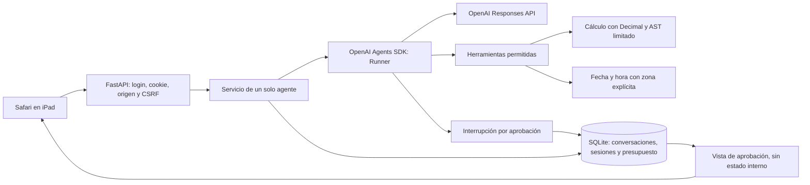

# Arquitectura y extensión



## Límites de confianza

El navegador no decide la identidad, los permisos, el presupuesto ni qué herramientas existen. Solo envía texto o una decisión booleana para una aprobación ya guardada. El servidor obtiene al propietario de una sesión válida y comprueba la pertenencia de cada conversación. No se reciben snapshots del SDK ni credenciales de OpenAI por los endpoints del chat.

El modelo propone llamadas a herramientas. El registro del servidor define la lista disponible y los efectos de cada función. Los hooks comprueban permisos, tamaño de contexto y cantidad de llamadas. La calculadora interpreta un subconjunto numérico del AST y nunca ejecuta código Python generado.

La API real usa `OpenAIResponsesModel` y `AsyncOpenAI` explícitos: no se comparte una clave mediante el frontend. `AI_MODEL` selecciona el modelo; `store=False`, trazas desactivadas y reintentos desactivados son decisiones del servidor.

## Una conversación normal

1. El usuario inicia sesión. Argon2id comprueba la contraseña. La cookie contiene un token aleatorio cuyo hash está en SQLite.
2. El navegador obtiene el token CSRF derivado de su sesión y lo conserva solo en memoria.
3. El servidor valida la petición, el propietario y el tamaño del historial; reserva presupuesto en una transacción.
4. El Runner recibe el historial y la nueva instrucción. Solo puede llamar a las herramientas registradas.
5. Se guardan la respuesta, los resultados de herramientas y los elementos de contexto del SDK. La reserva se ajusta al uso reportado.
6. Los logs contienen únicamente metadatos permitidos. El historial, que sí contiene el texto del usuario, se mantiene en el almacén privado.

## Añadir una herramienta

Define una función `async` con anotaciones de tipos y docstring. Regístrala al construir `AgentService` con una `ToolSpec`; no habilites registro dinámico desde HTTP.

```python
from backend.app.tools.registry import ToolSpec

async def update_order(order_id: str, status: str) -> dict:
    """Actualiza un pedido después de comprobar sus permisos.

    Args:
        order_id: Identificador del pedido autorizado para el usuario.
        status: Estado permitido por la API.
    """
    # Implementar validación, pertenencia, límites y clave de idempotencia.
    # No introducir credenciales en los argumentos ni aceptar URLs arbitrarias.
    raise NotImplementedError('Ejemplo documental; no está habilitado')

spec = ToolSpec(update_order, effect='write')
```

El registro aplica el timeout del servidor y obliga a que `effect='write'` requiera aprobación nativa del SDK. No basta con pedirle al modelo que solicite permiso. Una futura API debe comprobar sus propios permisos y ofrecer idempotencia; la aprobación por sí sola no resuelve duplicados tras un fallo externo.

No hay herramientas de escritura activadas en el servidor de producción inicial. Las pruebas añaden funciones ficticias para verificar toda la pausa, serialización, reinicio, aprobación/rechazo y protección contra repetición.

## Estado pendiente y recuperación

Los snapshots de `RunState` quedan solo en la base de datos del servidor, vinculados a propietario, conversación, versión de política y caducidad. La UI muestra únicamente las llamadas solicitadas y un identificador aleatorio. La transición que consume la solicitud es atómica. Ni un identificador adivinado ni una decisión repetida permiten reanudar otro estado.

Una interrupción del proceso o un error después de aprobar puede dejar incierto el resultado externo. La aplicación no repite esa acción automáticamente y bloquea la conversación afectada. La conciliación con la API externa y el uso de claves de idempotencia se añaden cuando exista una herramienta real de escritura.

## Despliegue y crecimiento

Esta versión utiliza un solo proceso, una sola réplica y SQLite en un volumen. Un lock de aplicación limita la concurrencia; las transacciones protegen presupuesto y aprobaciones. No se debe escalar aumentando workers o réplicas sin reemplazar la coordinación por un mecanismo distribuido y migrar la base de datos.

Para varios usuarios, añade un proveedor de identidad y una tabla de permisos. La vinculación de conversaciones ya usa `user_id`, pero la configuración de inicio solo da de alta al propietario. No interpretes la separación de sesiones como una plataforma multiusuario completa.
## Ampliación de perfil fiscal y facturación por Gmail

El paquete `backend/app/billing/` reutiliza la autenticación, configuración, SQLite y el agente existentes. Sus módulos separan modelos de datos, almacenamiento cifrado, documentos, extracción con el SDK, canales, Gmail OAuth/REST, consulta SAT, lógica del flujo, API privada y Telegram. `frontend/billing.js` y `billing.css` agregan el apartado fiscal sin reemplazar el chat.

Los documentos no entran en el historial general. `DocumentExtractor` utiliza una configuración del mismo agente con herramientas vacías, salida Pydantic estructurada, una sola llamada, timeout y almacenamiento del proveedor desactivado. El documento es entrada no confiable; no habilita navegación, shell ni acciones. El usuario debe autorizar su envío a OpenAI. Las pruebas no ejecutan extracción de pago.

`BillingStore` cifra cada payload con AES-256-GCM y nonce aleatorio. Tipo, propietario e ID se autentican como AAD; intercambiar un ciphertext entre usuarios falla. Los campos de búsqueda son HMAC; las consultas filtran por propietario. Los documentos se guardan cifrados en SQLite, no en rutas derivadas del nombre del archivo. Al listar documentos se retienen solo metadatos, evitando acumular todos los archivos descifrados en memoria. Los originales vencen por TTL y hay borrado explícito. No se promete borrar copias externas ni backups.

Las doce funciones fiscales se registran como herramientas del agente cuando el módulo está configurado. Sus resultados del chat contienen IDs/estados y orientaciones; los datos fiscales y documentos se consultan en la vista privada. Confirmar perfiles, verificar destinatarios, adjuntar CSF y enviar correos requiere una operación humana por la API protegida o un botón del chat privado autenticado de Telegram. La herramienta del modelo `send_invoice_request_email` solicita esa revisión: no puede confirmar ni enviar por sí sola.

La aprobación de correo es un snapshot cifrado del destinatario, texto, datos, versión de perfil y hashes de adjuntos. Se consume atómicamente antes del único intento externo. Un resultado ambiguo queda protegido contra repetición incluso después de caducar el borrador. El envío se registra como solicitud, nunca como factura completada. Para cotejar la respuesta se conserva el perfil autorizado en el envío, no se sustituye por cambios posteriores del perfil.

Gmail usa OAuth 2.0 con PKCE y estado aleatorio, de un solo uso y con vencimiento. Los tokens de cada propietario quedan cifrados. El callback verifica el estado y no depende de una cookie en la navegación de regreso desde Google. El cliente solo accede a destinos fijos de Google y a hilos almacenados de solicitudes propias; no acepta URLs del modelo. No renueva ni envía con reintentos automáticos. Desconectar elimina tokens locales; revocar el permiso en Google es una acción aparte del usuario.

Telegram exige secreto del webhook, ID numérico permitido y chat privado. Sus propietarios son HMAC del identificador del canal, separados del propietario de la web. Las actualizaciones se deduplican y tienen un límite diario. Se pide consentimiento antes de analizar un documento y se confirma el resumen antes de guardar el perfil. No se configura automáticamente un bot ni se vinculan identidades entre canales. WhatsApp podrá reutilizar los servicios con su propio adaptador y verificación de identidad.

`telegram_agent.py` adapta el texto libre al mismo `AgentService`, con los límites
y herramientas del Runner. Cada propietario de Telegram tiene una identidad
interna sin acceso web y conversaciones vinculadas por clave foránea. El ID de la
conversación activa se guarda en el estado cifrado; al recuperar o borrar se vuelve
a comprobar su propietario. `/conversaciones` permite recuperar conversaciones
anteriores; eliminarlas exige un botón explícito y no elimina perfiles fiscales.

`billing_workspace` devuelve solo IDs y estados propios. Las herramientas pueden
añadir eventos de revisión estructurados al contexto del servidor; estos se
traducen a botones en Telegram después de responder. No se interpretan como
acciones el texto o JSON generado por el modelo. El SDK también puede pausar
futuras herramientas de escritura: su aprobación va vinculada al propietario,
conversación, ID y caducidad. Las revisiones que excedan el límite del canal solo
permiten rechazar. No hay reintentos automáticos de ejecución o envíos.

Los asistentes de despliegue usan entrada oculta y escrituras privadas con copia
anterior. La primera cuenta se prueba con un código aleatorio enviado a un bot
nuevo; no se autoriza a la primera persona que escriba. Las invitaciones siguientes
son cambios manuales por ID realizados desde el servidor, nunca por el modelo.

Los adjuntos de Telegram se almacenan inicialmente como `unclassified`, cifrados
y sin enviar al modelo. El perfil, los botones o la descripción del usuario determinan su
tipo. Un ticket anterior al perfil permanece pendiente y se recupera cuando el
usuario confirma su perfil. `classify_document` reutiliza los bytes ya validados:
no vuelve a descargar, recomprimir o ampliar el TTL. Si se corrige un documento
que ya tuvo extracción con otro esquema, se conserva el original y su registro
de consumo y se prepara un documento tipado que requiere nueva autorización.
Las revisiones y clasificaciones vuelven a comprobar el propietario del archivo.

El agente recibe en su contexto del servidor la presencia de un perfil confirmado
y los metadatos del archivo activo. No se incluyen sus bytes, RFC, razón social o
datos de perfil en estas instrucciones. `review_received_document` permite pedir
la revisión de un archivo guardado, sin fingir que no se recibió ni extraerlo por
su cuenta. Mencionar régimen o correo en el chat no confirma un perfil fiscal.

El perfil fiscal confirmado es persistente e independiente del historial y del
TTL del original. Telegram lo reutiliza y clasifica las subidas posteriores como
tickets, salvo una indicación explícita de CSF. Si el alta quedó pendiente, conserva
la constancia y pide solo uso, correo, análisis o confirmación que falte. Una única
elección de perfil disponible puede recuperarse sin otra pregunta; varias sin
perfil activo exigen elegir. No se comparten perfiles entre usuarios.

Una extracción parcial no se presenta como archivo ilegible. El servidor enumera
campos fiscales pendientes y permite completarlos con entrada humana explícita,
validada y ligada al borrador propio. No se aceptan correcciones generadas por el
modelo ni se confirma el perfil sin revisar todos los datos. El régimen por nombre
se convierte mediante equivalencias exactas del catálogo; una descripción ambigua
queda pendiente. El PDF conserva sus bytes y puede ser escaneado, sin capa de texto.
Las imágenes usan detalle alto en la extracción para leer tipografía pequeña;
mantiene sus límites y consentimiento, aunque puede incrementar tokens de entrada.

Con un alta incompleta, un archivo de reemplazo no hereda el borrador fallido.
El estado de recepción y un nombre de archivo explícito de CSF orientan el tipo,
sin autorizar análisis ni validar el documento por su nombre. Puede recuperarse
el último PDF guardado y corregir su tipo con un botón ligado al propietario.

El módulo `telegram_profiles.py` controla alta y edición por botones en el chat,
sin depender de que el modelo invente pasos o redirija a la web. Las preguntas de
estado reconocidas, uso de CFDI y correo no solicitan generación. La herramienta
`review_fiscal_setup` entrega el mismo flujo al agente para otras formulaciones.
Las revisiones guardan propietario, versión del borrador y vencimiento; un botón
antiguo no confirma datos modificados. El perfil previo permanece vigente hasta
confirmar y los reemplazos conservan el ID y su versión para invalidar aprobaciones
de correo preparadas con datos anteriores.

Telegram pide frases con objetivo de 50 caracteres y un máximo de presentación
de 160, configurable. El proveedor recibe hasta 100 tokens de salida por llamada
del chat Telegram; la web conserva 150. El recorte posterior no reduce el consumo
ya generado ni se aplica a revisiones humanas. El historial, herramientas e
instrucciones siguen teniendo costo de entrada; `/nuevo` conserva datos fiscales
y abre contexto vacío. La extracción de documentos mantiene un presupuesto aparte.

El seguimiento periódico requiere habilitación del servidor y consentimiento por ticket para una política acotada. Solo lee Gmail: no envía recordatorios ni consulta al SAT. Conserva sus contadores, se detiene tras tres errores consecutivos o el máximo de consultas y deduplica los avisos de estado. La consulta de vigencia al SAT exige una autorización específica del usuario para RFC/UUID/importe; nunca adjunta la CSF. Coincidencias del XML y vigencia no equivalen a una validación criptográfica de sellos o al esquema XSD completo.

La configuración y los límites detallados están en [FACTURACION.md](FACTURACION.md).
