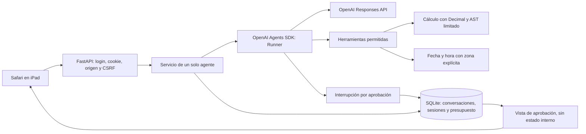

# Arquitectura y extensión



## Límites de confianza

El navegador no decide la identidad, los permisos, el presupuesto ni qué herramientas existen. Solo envía texto o una decisión booleana para una aprobación ya guardada. El servidor obtiene al propietario de una sesión válida y comprueba la pertenencia de cada conversación. No se reciben snapshots del SDK ni credenciales de OpenAI por los endpoints del chat.

El modelo propone llamadas a herramientas. El registro del servidor define la lista disponible y los efectos de cada función. Los hooks comprueban permisos, tamaño de contexto y cantidad de llamadas. La calculadora interpreta un subconjunto numérico del AST y nunca ejecuta código Python generado.

La API real usa `OpenAIResponsesModel` y `AsyncOpenAI` explícitos: no se comparte una clave mediante el frontend. `AI_MODEL` selecciona el modelo; `store=False`, trazas desactivadas y reintentos desactivados son decisiones del servidor.

## Una conversación normal

1. El usuario inicia sesión. Argon2id comprueba la contraseña. La cookie contiene un token aleatorio cuyo hash está en SQLite.
2. El navegador obtiene el token CSRF derivado de su sesión y lo conserva solo en memoria.
3. El servidor valida la petición, el propietario y el tamaño del historial; reserva presupuesto en una transacción.
4. El Runner recibe el historial y la nueva instrucción. Solo puede llamar a las herramientas registradas.
5. Se guardan la respuesta, los resultados de herramientas y los elementos de contexto del SDK. La reserva se ajusta al uso reportado.
6. Los logs contienen únicamente metadatos permitidos. El historial, que sí contiene el texto del usuario, se mantiene en el almacén privado.

## Añadir una herramienta

Define una función `async` con anotaciones de tipos y docstring. Regístrala al construir `AgentService` con una `ToolSpec`; no habilites registro dinámico desde HTTP.

```python
from backend.app.tools.registry import ToolSpec

async def update_order(order_id: str, status: str) -> dict:
    """Actualiza un pedido después de comprobar sus permisos.

    Args:
        order_id: Identificador del pedido autorizado para el usuario.
        status: Estado permitido por la API.
    """
    # Implementar validación, pertenencia, límites y clave de idempotencia.
    # No introducir credenciales en los argumentos ni aceptar URLs arbitrarias.
    raise NotImplementedError('Ejemplo documental; no está habilitado')

spec = ToolSpec(update_order, effect='write')
```

El registro aplica el timeout del servidor y obliga a que `effect='write'` requiera aprobación nativa del SDK. No basta con pedirle al modelo que solicite permiso. Una futura API debe comprobar sus propios permisos y ofrecer idempotencia; la aprobación por sí sola no resuelve duplicados tras un fallo externo.

No hay herramientas de escritura activadas en el servidor de producción inicial. Las pruebas añaden funciones ficticias para verificar toda la pausa, serialización, reinicio, aprobación/rechazo y protección contra repetición.

## Estado pendiente y recuperación

Los snapshots de `RunState` quedan solo en la base de datos del servidor, vinculados a propietario, conversación, versión de política y caducidad. La UI muestra únicamente las llamadas solicitadas y un identificador aleatorio. La transición que consume la solicitud es atómica. Ni un identificador adivinado ni una decisión repetida permiten reanudar otro estado.

Una interrupción del proceso o un error después de aprobar puede dejar incierto el resultado externo. La aplicación no repite esa acción automáticamente y bloquea la conversación afectada. La conciliación con la API externa y el uso de claves de idempotencia se añaden cuando exista una herramienta real de escritura.

## Despliegue y crecimiento

Esta versión utiliza un solo proceso, una sola réplica y SQLite en un volumen. Un lock de aplicación limita la concurrencia; las transacciones protegen presupuesto y aprobaciones. No se debe escalar aumentando workers o réplicas sin reemplazar la coordinación por un mecanismo distribuido y migrar la base de datos.

Para varios usuarios, añade un proveedor de identidad y una tabla de permisos. La vinculación de conversaciones ya usa `user_id`, pero la configuración de inicio solo da de alta al propietario. No interpretes la separación de sesiones como una plataforma multiusuario completa.
