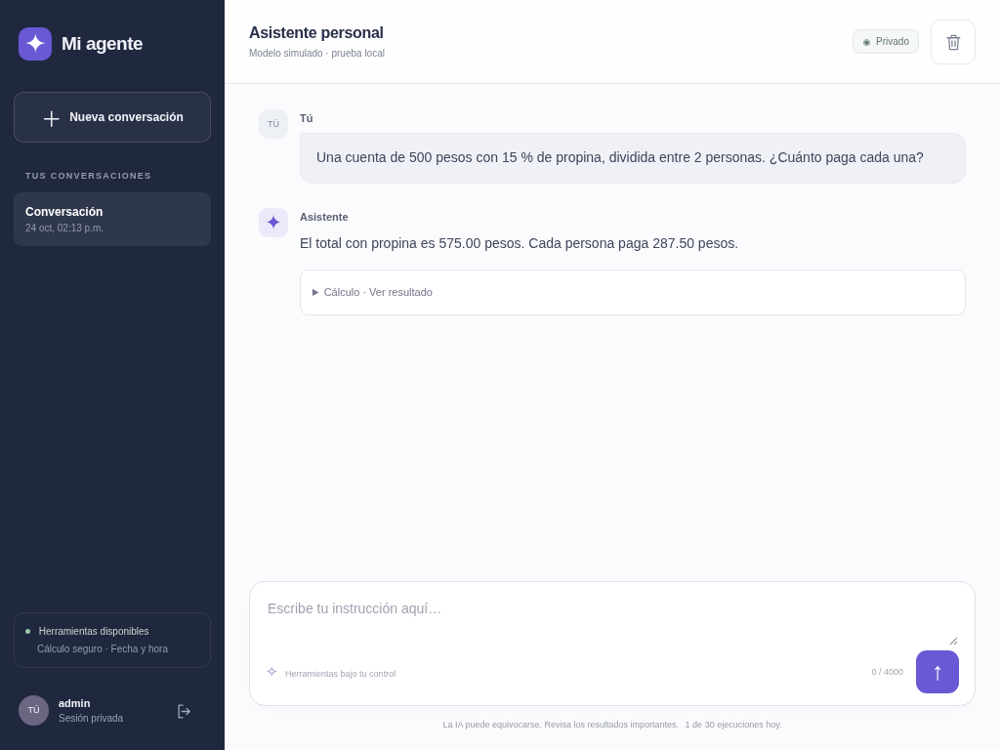

# Comprobaciones realizadas

La preparación y las pruebas automatizadas se ejecutaron localmente, sin llamadas de IA de pago. Después se realizaron pruebas reales con autorización del usuario; sus resultados se detallan abajo. **La aplicación no está desplegada en Railway.** El código se versiona en [kevinriosb/prueba-Codex](https://github.com/kevinriosb/prueba-Codex); publicar el repositorio no inicia un servicio web.

## Backend, seguridad y agente

Resultado actual de `.venv/bin/python -m pytest -q --tb=short`: **347 pruebas pasadas**, sin fallos ni pruebas omitidas. Las 58 comprobaciones originales se conservan. La preparación para Hostinger añadió una regresión que comprueba el rechazo de un PNG corrupto con HTTP 422, sin guardarlo ni llamar a IA, veinte pruebas de configuración del proxy, once pruebas de retirada reversible de referencias obsoletas, treinta del diagnóstico de OpenAI sin generación y veintisiete de sustitución privada de esa credencial. La conversación de Telegram añade quince pruebas; su configuración e invitaciones, veintinueve. La corrección de clasificación y recuperación de archivos añade trece regresiones; la reutilización de CSF y perfiles añade cinco. El flujo de perfil y las respuestas concretas añaden dieciséis regresiones, y el adaptador HTTP cubre además el límite específico de Telegram. La distinción de campos pendientes y recuperación de CSF añade veintitrés regresiones. La lectura de canales de tickets y solicitudes con CSF añade otras veintiséis.

Se comprobaron:

- `/health`, recursos estáticos y autenticación de rutas privadas.
- Cookies, CSRF, origen y host; límite de intentos de login; expiración de sesión y revocación al cambiar contraseña.
- Herramientas reales de cálculo y fecha/hora, ejecutadas por el Runner del OpenAI Agents SDK.
- Adaptador real `OpenAIResponsesModel` y cliente `AsyncOpenAI` con transporte HTTP simulado: llamadas a Responses, parámetros de seguridad, llamada a herramienta y devolución del resultado al modelo.
- Historial recuperable tras reiniciar y aislamiento de conversaciones entre propietarios.
- Rechazo de código arbitrario, expresiones caras, divisiones inválidas y números fuera de límites.
- Límites de tamaño, incluyendo solicitudes fragmentadas, contexto, concurrencia, herramientas, pasos y presupuesto diario.
- Timeout real de una ejecución simulada y contabilización conservadora del consumo desconocido.
- Pausa nativa del SDK antes de una escritura ficticia, aprobación, rechazo, caducidad, recuperación tras reiniciar y protección frente a modificaciones/repetición de la decisión.
- Bloqueo tras un fallo posterior a una acción aprobada: el efecto ficticio no se repite.
- Credenciales ausentes del estado persistido de aprobación, respuestas HTTP y logs de auditoría.
- Lectura de `HOST`, `PORT` y modelo desde `.env`, además del entorno del proceso. Las pruebas aíslan las credenciales reales de la máquina para no reutilizarlas.

Las respuestas de los modelos en estas pruebas están programadas. **Eso comprueba la integración y las políticas de la aplicación, no la calidad de las respuestas de un modelo real ni la disponibilidad de un modelo en una cuenta de OpenAI.**

## Interfaz

`scripts/browser_smoke.py` pasó con Chromium y el modelo simulado del servidor de pruebas:

- Login, sugerencia de cálculo, envío, resultado de herramienta e historial después de recargar.
- Confirmar y rechazar desde el chat.
- Un resultado con una etiqueta HTML se mostró como texto, sin ejecutar su código.
- Error del proveedor mostrado sin filtrar su mensaje interno.
- Logout y ocultación de conversaciones.
- Tamaños 1024 × 768, 768 × 1024, 375 × 812 y 320 × 640 sin desbordamiento lateral.
- Interacción táctil y apertura/cierre del menú de conversaciones con emulación de iPad.

No se comprobó un iPad físico ni Safari real. Las capturas en [screenshots/](screenshots/) muestran la aplicación de pruebas y llevan el rótulo «Modelo simulado · prueba local».

## Instalación y contenedor

- `uv sync --frozen` completado. La exportación de producción conserva versiones y hashes de los paquetes.
- `docker build` completado con `pip --require-hashes`, manteniendo TLS. La red de este entorno requirió montar su CA de confianza solo durante el build mediante `build_ca`; no se desactivó la verificación.
- `scripts/container_smoke.py` pasó: imagen arrancada localmente, `/health`, login, usuario de proceso UID 10001 y recuperación de una conversación y un documento fiscal cifrado al **eliminar y recrear** el contenedor usando el mismo volumen temporal. La clave de cifrado y el documento de esa prueba son ficticios; no hay IA ni correo real.
- El contenedor no incluye `.env` ni pruebas.
- Los contenedores y el volumen usados para estas pruebas se eliminaron al terminar.
- Sintaxis JavaScript y compilación de módulos Python comprobadas. `git diff --check` sin errores.

## Prueba real autorizada de OpenAI

Las llamadas reales descritas en esta sección pertenecen a la validación previa del agente general. La actualización fiscal **no realizó llamadas reales nuevas a OpenAI, Gmail, Telegram o SAT**, no compartió documentos fiscales ni emitió solicitudes de factura reales. Los adaptadores nuevos se comprobaron con transportes/proveedores simulados.

El usuario autorizó hasta dos llamadas a `gpt-4.1-mini`, con un máximo de 100 tokens de salida por llamada. Se hicieron **dos intentos**, con reintentos desactivados; el segundo después de que el usuario comunicó haber actualizado la clave. Ambos recibieron **HTTP 401, `invalid_api_key`**, antes de generar una respuesta. No se ejecutó la herramienta de cálculo en esas solicitudes y no se recibió un reporte de uso de tokens del proveedor.

Se comprobó que el secreto está vinculado y disponible, que no hay espacios exteriores, saltos de línea, comillas envolventes, una asignación de variable ni un prefijo `Bearer` añadido. La aplicación utiliza el valor actual del entorno; no existe un archivo `.env` local que lo sustituya. El destino y la cabecera de autenticación del cliente son los esperados. No se mostraron ni guardaron valores de credenciales.

Después del segundo rechazo, se consultó **GET `/v1/models`**, primero mediante la biblioteca estándar y después mediante el cliente oficial `AsyncOpenAI`: ambas consultas recibieron HTTP 200. Sin embargo, un control posterior de **GET `/v1/models/gpt-4.1-mini` sin cabecera Authorization también recibió HTTP 200** en este entorno. Por tanto, estos resultados **no validan la credencial**. La afirmación anterior de que la clave había sido aceptada fue una conclusión incorrecta a partir de ese listado. Estas consultas no solicitaron generación ni consumieron tokens de inferencia.

La configuración de la aplicación, `/health`, el login, el acceso autenticado al historial y el logout se verificaron con las credenciales configuradas. Antes del segundo intento se comprobó localmente, con un modelo simulado, que el SDK puede devolver directamente el resultado real `287.5` de `calculator` y recuperar el historial utilizando una sola llamada al modelo. Este modo se aplicó únicamente a esa comprobación, sin cambiar el comportamiento de la aplicación.

El usuario autorizó después **hasta dos llamadas adicionales**, con el mismo modelo y límite de 100 tokens de salida por llamada. Se utilizó primero **una**: volvió a recibir HTTP 401, `invalid_api_key`, sin reporte de uso ni ejecución de herramientas. Se detuvo la prueba, sin reintentar la misma solicitud. En ese momento quedaba una llamada dentro de esta segunda autorización; se usó después en la prueba con variable directa descrita abajo.

Para aislar el problema sin generar texto se envió, mediante la biblioteca estándar y la ruta HTTPS habitual, un POST a `/v1/responses` con cuerpo `{}`, sin modelo ni entrada: también devolvió HTTP 401, `invalid_api_key`. Una captura local con transporte simulado verificó que el adaptador del SDK prepara el destino correcto, una única cabecera Authorization que coincide con la credencial configurada, el modelo autorizado, el límite de 100 tokens y `store=false`. Después de que el usuario publicó de nuevo el entorno, la misma comprobación sin generación siguió recibiendo HTTP 401 usando el secreto de red.

## Prueba real con variable directa

Se añadió la variable de diagnóstico `AI_API_KEY_CHECK` y el usuario suministró su valor mediante Variables de entorno y publicó la configuración. La comprobación POST sin modelo ni entrada usando esa variable devolvió **HTTP 400, `missing_required_parameter`, parámetro `model`**, en lugar del rechazo de autenticación. Esto permitió probar la llamada restante autorizada sin seguir consumiendo intentos con el secreto de red.

La prueba real pasó con **HTTP 200**:

- Modelo: `gpt-4.1-mini`, una sola llamada, máximo 100 tokens de salida y sin reintentos.
- El modelo llamó a la herramienta real `calculator` para calcular `(1250 + 350) / 4`; la herramienta devolvió **400**.
- El SDK reportó **268 tokens de entrada y 24 de salida**.
- Se recuperaron los mensajes y el evento de herramienta por la API privada, tanto en la misma aplicación como después de cerrarla y crear otra instancia sobre la misma base de datos.
- Login y logout correctos, sin guardar ni mostrar credenciales en el informe.

Para respetar la única llamada restante se aplicó `stop_on_first_tool` exclusivamente en la prueba: el resultado de la herramienta se devolvió directamente. **No se generó una segunda respuesta del modelo después de la herramienta ni se cambió el comportamiento normal de la aplicación.** Las conversaciones normales de varias llamadas siguen verificadas con modelos simulados en las pruebas automatizadas.

También se inició el servidor real mediante `.venv/bin/python -m backend.app`, pasando la variable directa como `AI_API_KEY` solo en el entorno de ese proceso. Se verificaron `/health`, login, configuración privada, recuperación de la conversación real y logout por HTTP local. Se detuvo únicamente el servidor iniciado para esa comprobación; no se hicieron llamadas adicionales al modelo.

La clave de la variable directa funciona. Sigue sin determinarse por qué el valor o la aplicación del vínculo de Secretos de red produce un rechazo; ese vínculo se conserva. Las instrucciones de inicio guardadas ahora dan prioridad a `AI_API_KEY_CHECK` al establecer `AI_API_KEY` para el proceso local, sin imprimir valores ni escribirlos en archivos. En Railway se debe configurar `AI_API_KEY` directamente como variable privada, siguiendo el README; la variable de diagnóstico no es necesaria allí.

**Los dos cupos de dos llamadas autorizados están agotados**: tres intentos recibieron 401 y el último pasó. Cualquier nueva generación de IA requiere nueva autorización. Las comprobaciones HTTP sin modelo no solicitaron generación ni consumieron tokens de inferencia.

## Comprobaciones para publicar el código

Antes de publicar se repitió la suite: **58 pruebas pasadas**, sin llamadas de IA ni cargos. La sintaxis de `frontend/app.js` pasó la comprobación de Node.js.

En la actualización de facturación la suite pasó a **105 pruebas**. Se verificaron primera interacción sin perfil, consentimiento de análisis, CSF ilegible/incompleta, confirmación, varios perfiles, actualización y borrado, AES-GCM con propietario autenticado, formatos y vencimiento de archivos, contacto oficial y verificación manual del ticket, prioridad de portal compatible, aprobaciones, duplicados y diferencias de formato del importe. Se comprobaron envíos desactivados, cambios de perfil tras revisar el borrador, dos confirmaciones concurrentes con un único efecto, envío de resultado incierto y conservación de su bloqueo, CSF con autorización específica, XML/PDF, respuestas sin XML, destinatario/hilo incorrectos y XML con entidades o datos incompatibles.

También se verificaron identificadores largos de adjuntos de Gmail, su codificación segura en la ruta, orientación de fotografías al retirar metadatos personales, OAuth de Gmail con PKCE/estado de un solo uso, renovación y tokens cifrados, envío MIME y lectura de adjuntos mediante transporte HTTP simulado; webhook de Telegram con secreto/usuarios autorizados, flujo CSF con botones, aislamiento entre canales y rechazo de rutas de descarga indebidas; consulta SAT simulada y su desactivación por configuración; seguimiento autorizado, límite de consultas, parada tras tres errores y ausencia de avisos repetidos. Un cambio posterior de perfil no altera los datos autorizados que se cotejan con la respuesta del envío anterior.

`scripts/billing_browser_smoke.py` pasó con Chromium y emulación táctil de iPad: CSF ficticia, selección explícita del uso de CFDI, correo, perfil, ticket, revisión del destinatario, borrador, rechazo/envío simulado, lectura de una respuesta con HTML mostrado como texto inerte, historial y limpieza de datos fiscales al cerrar sesión. No hubo desbordamiento lateral a 1024×768, 768×1024, 375×812 y 320×640. La prueba de navegador del chat original también pasó. No se comprobó un iPad físico ni Safari real.

La guía de configuración y los límites de estas integraciones están en [FACTURACION.md](FACTURACION.md). WhatsApp, los adaptadores de portales comerciales, la validación XSD completa y la verificación criptográfica de sellos no se presentan como implementados.

Se revisaron los archivos de publicación para detectar las credenciales configuradas, formatos conocidos de claves y artefactos privados. No se encontraron credenciales. `.env`, `.local/`, `.venv/` y `data/agent.sqlite3` están excluidos de Git. El archivo `.env.example` contiene nombres y valores de ejemplo, sin secretos. La publicación en GitHub no autoriza ni ejecuta el despliegue en Railway.

## Pendiente para una prueba real desde el iPad

### Preparación local para Hostinger

Se añadieron `compose.hostinger.yaml`, una plantilla sin secretos y un asistente
interactivo compatible con Python 3.9+ del VPS. El agente continúa usando Python
3.12 dentro de Docker. Codex no estableció una conexión SSH al VPS. Posteriormente
el usuario ejecutó la instalación en Termius y compartió su salida: contenedor
`healthy`, `/health` local correcto, DNS del subdominio hacia su VPS y HTTPS de
CyberPanel con HTTP 200. Esa respuesta todavía correspondía al sitio estático:
faltaba aplicar la conexión al backend y probar Telegram. Después compartió la
salida de la retirada de referencias y del proxy: ambas validaciones pasaron,
se guardaron copias privadas y `/health` respondió por HTTPS con
`{"status":"ok","version":"0.1.0"}`. También compartió una captura del chat
autenticado en el iPad con un error genérico del proveedor de IA. Esa captura
confirma que la interfaz abre, pero no permite determinar la causa del fallo de
OpenAI. Telegram y Gmail siguen pendientes de conexión.

Se añadió `scripts/check_openai.py` para ejecutarlo por stdin dentro del
contenedor y comprobar su entorno efectivo. Sus treinta pruebas simulan los
transportes: control sin credencial, rechazo de claves, permisos, cuota,
metadatos del modelo, respuestas inesperadas y voluminosas, DNS, timeout, TLS y
redirecciones. Se comprueba que solo se envían cuerpos vacíos o consultas de
metadatos, sin prompts, y que no se imprimen secretos o mensajes del proveedor.
La comprobación no demuestra que exista saldo ni que generar una respuesta
funcione. El usuario la ejecutó después dentro de su contenedor en el VPS y
compartió el resultado: **HTTP 401, credencial rechazada**. Esto identifica el
rechazo de la credencial que usa ese proceso. Codex no accedió por SSH al VPS ni
recibió el valor de la clave.

Se añadió `scripts/update_openai_key.py`, compatible con Python 3.9 y sin
dependencias, para cambiar únicamente `AI_API_KEY` desde Termius. Sus pruebas
verifican copia privada, permisos y propietario, preservación exacta de las
otras variables y finales de línea, rechazo de formatos ambiguos y enlaces,
conservación de ediciones concurrentes y fallo de escritura sin sustituir el
original. Una prueba ejecuta el script en una pseudoterminal real: la entrada
oculta está activada al pegar la clave ficticia y el valor no aparece en la
salida. No se ha modificado la configuración real del usuario ni efectuado
generación de IA durante esta actualización. La sustitución de la clave y su
nueva comprobación en el VPS quedan a cargo del usuario.

El usuario completó después la sustitución en Termius y compartió su salida:
contenedor healthy, control de autenticación de Responses aceptado y metadatos
del modelo con HTTP 200. A continuación compartió una captura de la prueba real
desde Safari: respuesta de 575 pesos en total y 287.5 por persona, con dos
resultados de la herramienta de cálculo visibles. No se recibió el reporte de
tokens o costo de esa ejecución. Codex no inició llamadas adicionales al modelo.

### Conversación con IA e invitaciones en Telegram

Se implementó el adaptador al mismo `AgentService`, sin otro agente ni nuevas
dependencias. Las pruebas usan el Runner y herramientas reales con modelo y
transporte simulados. Comprueban cálculo sin perfil fiscal, presupuesto e
historial independientes, recuperación tras reiniciar, selección y eliminación
confirmada de conversaciones propias, duplicados concurrentes y rechazo de
mensajes de grupos o cuentas no invitadas sin llamar al modelo.

Se comprobaron aprobación y rechazo de una escritura ficticia, bloqueo de otro
usuario y de su repetición, ausencia de un botón de aprobación si no cabe la
revisión completa, consulta de IDs propios sin revelar campos fiscales ajenos,
consentimiento obligatorio antes de analizar y un borrador solicitado en lenguaje
natural que no envía correo hasta recibir la confirmación de su propietario.

Los asistentes de Telegram se probaron sin APIs reales: vinculación por código
exacto y chat privado, rechazo de bots y códigos ambiguos, conservación de claves,
copia privada, autorización y retirada manual por ID, registro explícito y
verificación de URL de webhook, rechazo de reemplazar la dirección de otro servicio
y rechazo de listas abiertas o IDs inválidos. La sintaxis de los asistentes del
VPS se comprobó para Python 3.9.

La imagen Docker actualizada se construyó y pasó `scripts/container_smoke.py`:
salud, login, UID sin privilegios y recuperación de historial y documento fiscal
cifrado al recrear con volumen. La validación de `configure_telegram.py` ejecutado
por stdin dentro de esa imagen pasó con la red desactivada y valores ficticios.
Los recursos de prueba se eliminaron; no se cambió el VPS.

El usuario creó y vinculó un bot nuevo, aplicó la actualización y registró el
webhook desde Termius. Compartió tanto la salida de registro correcto como
capturas de la bienvenida y de una respuesta en lenguaje natural sobre las
capacidades de facturación. Eso comprueba la conversación por Telegram; no
demuestra todavía que se haya completado una solicitud de factura. Gmail, envíos,
copias de seguridad y pruebas con dos cuentas siguen pendientes.

### Corrección del tipo de documento y recuperación de archivos

El usuario mostró un ticket rechazado como CSF y una respuesta que le pedía
subirlo de nuevo. Se corrigió el supuesto que asignaba CSF a cualquier primer
archivo sin perfil confirmado. Telegram ahora pregunta el tipo y conserva los
tickets pendientes mientras se confirma el perfil. Los archivos anteriores se
pueden recuperar con `/documentos` o una declaración explícita de su tipo.

Trece pruebas con archivos y extracción simulados comprueban selección previa sin
IA, ticket anterior al perfil y continuación con los mismos bytes, CSF con perfil
ya existente, recuperación de un archivo antiguo mal clasificado y conservación
del intento anterior, rechazo de controles de otro usuario, estado real sin campos
fiscales en el contexto del agente, revisión por herramienta y clasificación
idempotente sin ampliar el vencimiento. El estado interno sin clasificar no se
expone como opción de subida en la API web. No se realizaron nuevas extracciones
de pago ni se utilizó el ticket real del usuario en las pruebas. La corrección
requiere actualizar y recrear el contenedor en el VPS; no se aplicó por SSH.

### Respuestas breves y CSF reutilizable (versión anterior)

Las instrucciones se compactaron y piden 1–2 frases, con máximo orientativo de
35 palabras. El valor predeterminado de `MAX_OUTPUT_TOKENS` cambió de 600 a 150.
La prueba del adaptador HTTP real del SDK comprueba que OpenAI recibiría
`max_output_tokens=150`; no se trata de recortar una respuesta ya generada.
Las lecturas estructuradas conservan su límite independiente. No se hicieron
generaciones reales para evaluar la calidad o longitud del texto nuevo.

Con un perfil confirmado, una subida sin descripción se procesa como ticket.
La descripción `/csf` conserva la opción de agregar o actualizar una constancia.
Si ya llegó la CSF pero falta terminar el alta, solo se pide el paso pendiente.
Cinco regresiones adicionales comprueban la excepción explícita de CSF, el perfil
conservado tras `/nuevo` y vencimiento del original, alta pendiente de uso/correo,
CSF recibida sin analizar y aislamiento del perfil de otro usuario. Las pruebas
anteriores también comprueban el nuevo valor por defecto de ticket.

El historial anterior permanece guardado: `/nuevo` abre contexto vacío sin borrar
perfiles ni tickets. Entradas, herramientas e imágenes siguen consumiendo tokens;
estas modificaciones no garantizan un porcentaje fijo de ahorro monetario.

### Respuestas concretas y confirmación del perfil en Telegram

La versión actual pide una frase con objetivo de 50 caracteres y fija un máximo
de presentación de 160 para texto de IA. Las ofertas genéricas finales se retiran
sin pedir otra generación. La prueba del adaptador Responses con HTTP simulado
verifica `max_output_tokens=100` para Telegram y 150 para la web, además de
`store=false`, llamadas a herramientas y retorno de su resultado. Recortar el
texto ya generado no reduce su consumo; el límite del proveedor y los pasos
resueltos sin IA son las medidas de control. La extracción mantiene su presupuesto
independiente. No se hicieron nuevas generaciones reales para medir calidad.

Las pruebas recorren alta completa sin abrir la web, selección explícita de uso
por botón, captura de correo, revisión completa, confirmación de un solo uso,
edición sin modificar el perfil previo, rechazo de botones anteriores tras editar,
aislamiento de propietarios, descarte de cambios y reemplazo de CSF conservando
el ID del perfil. Un «sí» no confirma ni autoriza el análisis. También comprueban
que un borrador caducado recupera la extracción disponible sin otra llamada de IA,
que cambiar el correo no exige el original ya vencido, que una CSF antigua no
reinicia el alta tras un reemplazo y que se conserva la elección de uso guardada
por la versión anterior. Los botones antiguos abren una revisión nueva.

La herramienta `review_fiscal_setup` abre el flujo del servidor en este mismo
chat; no interpreta JSON del modelo como acciones ni remite al portal web.
Las revisiones de aprobación muestran todos los datos y no se recortan. No se
hicieron llamadas reales a OpenAI, Telegram, Gmail o SAT durante estas pruebas.
La aplicación de esta versión al VPS queda a cargo del usuario desde Termius.

### CSF parcialmente extraída y PDF de reemplazo

La captura del usuario mostró «CSF ilegible» después de crear un borrador: ese
mensaje se usaba para cualquier campo ausente o inválido. También mostró nuevos
PDF tratados como tickets por existir un alta pendiente. Se corrigieron ambas
condiciones; no se atribuye al archivo una falta de legibilidad sin evidencia.
El campo pendiente aparece expresamente y puede completarse desde la CSF, con
validación del servidor y revisión final antes de confirmar. La entrada de estos
campos no se envía al modelo ni dispara otra extracción.

Las pruebas nuevas comprueban equivalencias exactas de regímenes por nombre,
rechazo de descripciones ambiguas, cuatro tipos de campo pendiente, botones ligados
al propietario, rechazo de un valor inválido, sustitución del PDF sin heredar el
borrador anterior, conservación del perfil al reemplazar una CSF de actualización,
recuperación del último PDF guardado sin otra subida y que una queja de texto no
se use como nombre fiscal. Una prueba genera un PDF escaneado ficticio sin capa
de texto y verifica que el Runner recibe sus bytes completos como `input_file`.
Las fotos utilizan `detail=high`, comprobado en la entrada del adaptador; eso puede
aumentar tokens de entrada respecto a `low`, sin reintentos automáticos.

La imagen actualizada pasó `scripts/container_smoke.py`: salud, login, UID 10001,
exclusión de secretos/pruebas y persistencia de historial y documento cifrado tras
recrear el contenedor. No se hicieron nuevas llamadas reales a OpenAI, Telegram,
Gmail o SAT. El PDF personal del usuario no se recibió ni analizó en estas pruebas;
la verificación de su resultado concreto se realizará tras actualizar el VPS.

### Tickets con página, QR o correo de facturación

Se reprodujo con el Runner real y una respuesta programada la lectura de una URL
sin esquema y un importe con símbolo de moneda. El validador anterior podía
rechazar toda la extracción; ahora normaliza campos visibles y conserva los demás
si uno no es interpretable. Un ticket parcialmente legible permanece guardado y
permite completar el dato pendiente por comando humano, sin otra llamada a IA.
Los fallos de autenticación, cuota, timeout y formato conservan códigos seguros,
sin imprimir respuestas o excepciones del proveedor ni atribuirlos a la CSF.

Las regresiones verifican normalización de URL, rechazo de esquemas indebidos,
credenciales en enlaces y direcciones internas; QR sintéticos reales leídos con
ZXing-C++, descarte de QR de encuesta como canal fiscal, visualización del portal
y datos propios, aislamiento de botones, preparación de correo con CSF elegida por
el usuario y envío MIME simulado tras una sola confirmación válida. Gmail inactivo
solo ofrece vista previa; no muestra un botón para enviar. También se verifican
la recuperación autorizada de un ticket que falló antes de la actualización,
conservación de bytes/TTL, ausencia de un segundo intento en la misma versión,
diagnóstico del documento actual y consulta del ticket tras vencer su original.

La nueva dependencia está fijada en `pyproject.toml`, `uv.lock` y requisitos con
hashes. El Dockerfile de producción se construyó y se ejecutó el smoke de salud,
login y persistencia. El entorno local requirió resolver el proxy de construcción
y montar su CA de confianza; se mantuvieron TLS y verificación de hashes, sin
cambiar el Dockerfile ni los requisitos de red del VPS. La lectura de un QR real
sintético también pasó dentro de la imagen con red desactivada y UID sin privilegios.

No se hicieron nuevas llamadas de generación ni se enviaron correos reales. La
consulta de la página pública del comercio no pudo completarse desde este entorno;
no se enviaron datos fiscales ni se desarrolló o validó un automatismo para ese
portal. El ticket personal mostrado en la captura no se analizó con el proveedor.
Google OAuth y la conexión individual de Gmail siguen pendientes de configuración
en el VPS. No se ha afirmado una factura emitida ni un envío real completado.

- `scripts/hostinger_smoke.py` pasó con la imagen actualizada: configuración de
  producción real, puerto publicado únicamente en loopback, host autorizado,
  cookies seguras, contraseña ficticia con caracteres especiales, rechazo de
  sobrescritura de configuración, usuario sin privilegios y raíz de solo lectura.
- Se recuperaron historial y un documento fiscal cifrado después de eliminar y
  recrear el contenedor con el mismo volumen y clave. Un PNG corrupto recibió 422.
- El asistente se ejecutó en una pseudoterminal real con contraseña ficticia:
  entradas privadas ocultas, archivo con permisos 600 y configuración previa
  conservada. Se comprobó la sintaxis de ambos scripts para Python 3.9.
- No hubo llamadas a OpenAI, Gmail, Telegram o SAT. Los contenedores y volumen de
  estas pruebas se eliminaron. No se alteraron DNS, CyberPanel ni el sitio actual.

Para el virtual host compartido por el usuario se preparó el asistente
`configure_cyberpanel_proxy.py`. Veinte pruebas comprueban conservación de ACME/TLS,
rechazo de rutas o reglas existentes, repetición sin duplicar bloques, copia
privada, ediciones concurrentes detectadas y restauración de archivo/recarga ante
fallos de validación o salud. Su aplicación por el usuario quedó confirmada por
la salida del asistente y `/health` por HTTPS compartidos en la conversación.

`scripts/cyberpanel_proxy_smoke.py` pasó con OpenLiteSpeed 1.9.3 real en Docker y
el backend real sin clave de IA. Se verificaron TLS con una CA ficticia de prueba
(sin desactivar verificación), conservación de Host/Origin, login y cookies
seguras, redirección HTTP→HTTPS, challenge ACME accesible por HTTP, no-store y
accesslog sin el código ficticio incluido en la query string. Los contenedores,
datos y certificado de prueba se eliminaron. No se hicieron llamadas a APIs ni
cambios en el VPS. El asistente validará además la versión/configuración real
del servidor antes de aplicar y recargar.

El intento compartido desde el VPS se detuvo antes de crear una copia o modificar
el sitio: la validación global devolvió código 2 con errores de configuraciones
antiguas. El usuario confirmó que esos dominios ya no se utilizan; se necesita
revisar sus bloques y mappings completos antes de desactivar referencias. No se
han eliminado archivos, certificados ni contenedores.

El asistente distingue ahora los avisos de validación: se comprobó con el binario
real de OpenLiteSpeed que `-t` puede devolver 1 con registros WARN y sin errores.
Ese caso se acepta solo si todos los registros tienen un formato reconocido.
Errores incluso con código 0, código 2, salidas desconocidas, señales de fallo y
recargas con código no cero se rechazan. El diagnóstico muestra código y
contadores, sin copiar datos privados de la salida a los logs del asistente.

Tras revisar los bloques completos compartidos por el usuario se añadió
`retire_cyberpanel_domain.py`: solo prepara el archivo global, con copia privada,
y valida la propuesta sin recargar. Las once pruebas verifican cinco definiciones
antiguas, incluidas duplicadas, once mappings, conservación exacta de las rutas
protegidas, sustitución del respaldo TLS por un par ya utilizado, rechazo de
aliases mezclados o certificados ambiguos, funcionamiento idempotente y
restauración ante fallo. Archivos y datos ficticios de otra aplicación conservan
sus bytes. No hay operaciones sobre Docker ni borrado de directorios o certificados.

La prueba real de OpenLiteSpeed también pasó con esa propuesta de retirada y
ambos listeners HTTPS: el archivo antiguo con sintaxis inválida permanece en
disco, pero deja de referenciarse; se conserva el acceso al backend con el
certificado de respaldo reutilizado. Este ensayo usa dominios, archivos y
certificados ficticios. Ninguna referencia de producción se ha desactivado aún
desde Codex; la aplicación de los comandos queda en la terminal del usuario.

Los respaldos y su recuperación, Gmail/Telegram y la prueba fiscal completa en
Safari continúan pendientes. El chat web sí fue comprobado por el usuario en su
iPad. La guía de alojamiento es [HOSTINGER.md](HOSTINGER.md).

### Configuración del entorno de desarrollo y otras opciones

La configuración de Codex y la del VPS son independientes. Publicar un entorno
de desarrollo o hacer push a GitHub no cambia por sí solo las variables o la
imagen activa del VPS. Las actualizaciones de esta instalación se aplican en
Termius, conservando su archivo privado, volumen y clave de cifrado.

Railway continúa como alternativa documentada: no se creó ni desplegó un servicio
en esa plataforma. El alojamiento elegido por el usuario es su VPS existente.
No se han contratado recursos nuevos durante esta actualización.

### Cuenta, folio y requisitos del formulario

Veinticinco regresiones adicionales comprueban la extracción independiente de
Cuenta/Folio/Referencia con el Runner, lectura de etiquetas asociadas y anidadas,
rechazo de controles ocultos o de contraseña e instrucciones dentro de scripts,
campos pendientes y referencias alternativas sin validar. También cubren tickets
con Cuenta y sin Folio, identificadores sensibles a mayúsculas, edición de una
Cuenta pendiente desde Telegram y relectura autorizada de un ticket válido
anterior a esta versión sin duplicar la solicitud, alterar bytes ni ampliar su TTL.

El cliente HTTP se comprobó con transporte simulado: GET a una IP pública fijada,
Host/SNI del comercio, sin body, query, cookies ni Authorization. DNS privado o
mixto impide cualquier llamada HTTP; una URL no aprobada no llega a resolver DNS.
Las redirecciones fuera de las páginas permitidas se rechazan y se acepta una
redirección segura que añade una barra final. No se envían cuentas, RFC ni datos
del perfil para leer el formulario. Leer campos y validar la compra tienen estados
separados; no se pulsa Siguiente ni se solicita una factura. Cambiar un identificador
de compra invalida una aprobación nueva de correo con los datos anteriores.

La consulta real al portal no pudo completarse desde este entorno. La captura
del usuario es la evidencia de que Al Bat pide Cuenta; su plantilla se etiqueta
como tal y no se presenta como consulta en vivo. No se hicieron nuevas llamadas
de generación, consultas de cuentas de consumo ni envíos reales. La imagen se
construyó, pasó el smoke de salud/login/persistencia y el JavaScript modificado
pasó la comprobación de sintaxis. Falta probar la consulta pública desde el VPS
y verificar la Cuenta extraída del ticket real.
